<div align="center">


# MyStore

**Tu propia Play Store: sube tus APKs una vez e instálalas en el móvil y el reloj Wear OS sin cables.**

[](LICENSE)
[](server/go.mod)
[](android/)
[](android/wear)
[](docker-compose.yml)
[](https://github.com/adriarroyo08/mystore/actions/workflows/ci.yml)

[Cómo funciona](#-cómo-funciona) · [Empezar en 5 minutos](#-empezar-en-5-minutos) · [Referencia técnica](#-referencia-técnica) · [FAQ](#-preguntas-frecuentes)

</div>

---

## ✨ ¿Qué es?

MyStore es una tienda de apps **personal, open source y autoalojada**. Montas un servidor (un solo binario en Docker), subes tus APKs desde el navegador, la terminal o GitHub, y las instalas o actualizas **con un toque** desde una app tipo Play Store en tu móvil y en tu reloj.

> **El problema:** compilas tu app y luego toca enchufar el cable, pelearte con `adb` o pasarte la APK por Telegram. En el reloj es aún peor.
> **La solución:** `git push` → la APK aparece en tu tienda → el móvil o el reloj te avisa de que hay versión nueva → *Actualizar*.

Cada persona monta su propia tienda: sin cuentas, sin registro y sin base de datos.

## 📸 Capturas

<table align="center">
  <tr>
    <td align="center">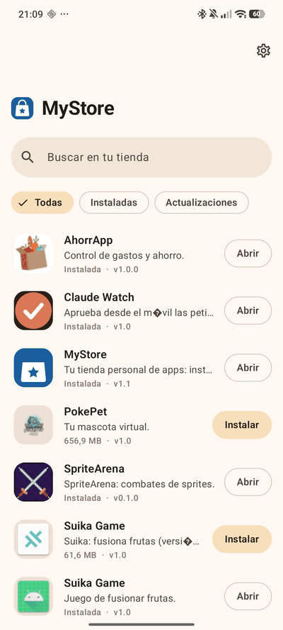<br><sub>Inicio (claro)</sub></td>
    <td align="center">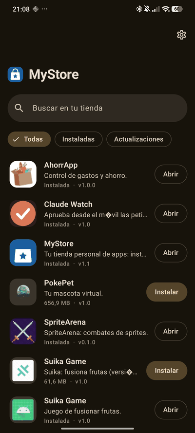<br><sub>Inicio (oscuro)</sub></td>
    <td align="center">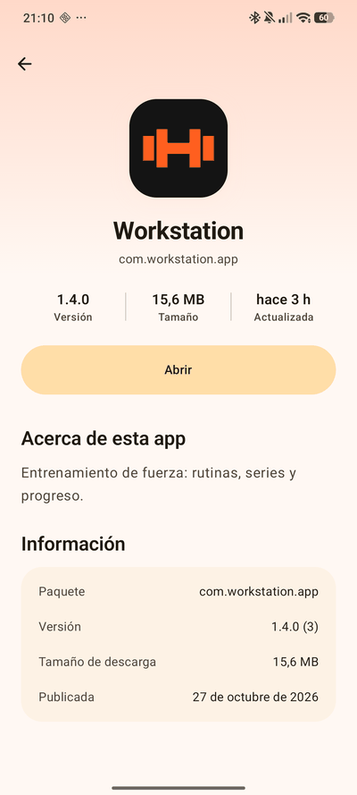<br><sub>Ficha de la app</sub></td>
  </tr>
  <tr>
    <td align="center">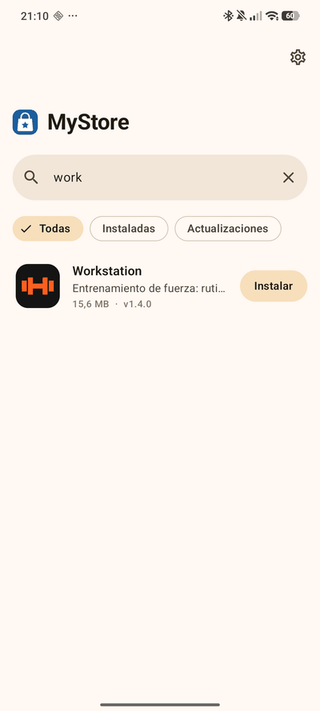<br><sub>Búsqueda</sub></td>
    <td align="center">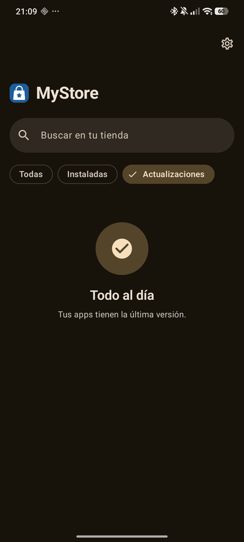<br><sub>Filtro «Actualizaciones»</sub></td>
    <td align="center">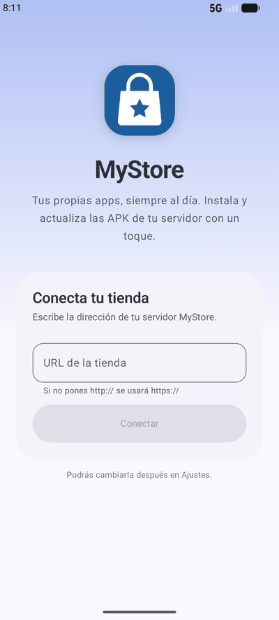<br><sub>Primer arranque</sub></td>
  </tr>
</table>

<p align="center">
  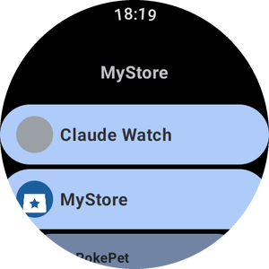
  &nbsp;&nbsp;
  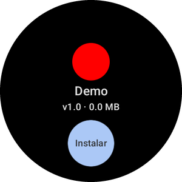
  &nbsp;&nbsp;
  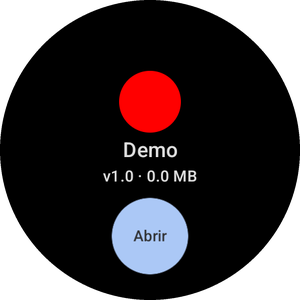
  <br>
  <sub>Wear OS: lista desplazable con la corona · <i>Instalar</i> · <i>Abrir</i> tras instalar</sub>
</p>

## 🧭 Cómo funciona

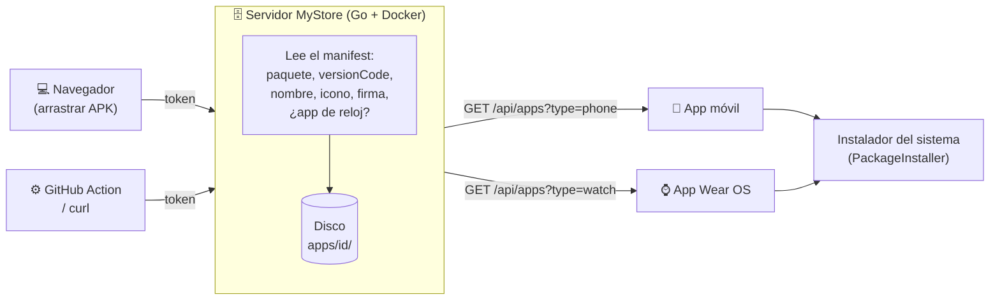

Y así llega una actualización hasta tu muñeca:

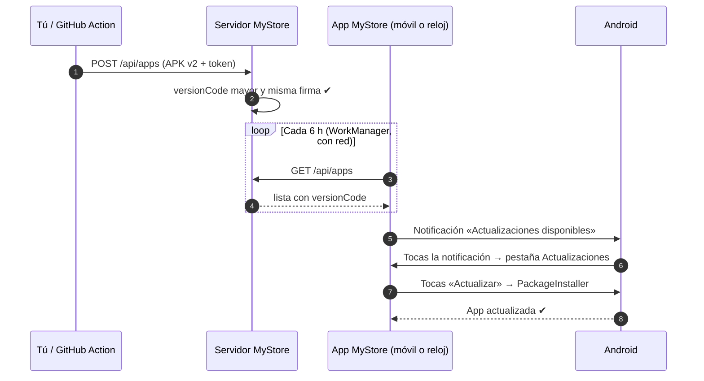

## 🧩 Funciones

| | | |
|---|---|---|
| 🆔 **Identidad paquete + tipo**<br><sub>La versión móvil y la de reloj de una app conviven sin pisarse</sub> | 🔏 **Control de firma**<br><sub>Rechaza APKs firmadas con otra clave</sub> | ⬆️ **Sin downgrades**<br><sub>El `versionCode` siempre tiene que subir</sub> |
| 🎨 **Iconos de verdad**<br><sub>Extrae PNG y rasteriza adaptativos, vectoriales y WebP</sub> | 🖼️ **Capturas y descripción**<br><sub>Ficha tipo Play Store (hasta 8 capturas)</sub> | 🧷 **Icono personalizado**<br><sub>Para APKs que no traen icono</sub> |
| 💅 **Material You**<br><sub>Colores dinámicos, tema claro/oscuro, búsqueda y filtros</sub> | ⌚ **App Wear OS**<br><sub>Lista redonda, instalar sin adb</sub> | 🔔 **Avisos en segundo plano**<br><sub>Comprueba cada 6 h y notifica solo lo nuevo</sub> |
| ♻️ **Se actualiza sola**<br><sub>Las apps tienda aparecen en su propia lista</sub> | 🤖 **GitHub Action**<br><sub>Sube la APK en cada release</sub> | 🐳 **Docker + sin BD**<br><sub>Un binario, un volumen, ficheros JSON</sub> |

## 🚀 Empezar en 5 minutos

<details>
<summary><b>1. Despliega el servidor con Docker Compose</b></summary>

```bash
git clone https://github.com/adriarroyo08/mystore.git
cd mystore
export MYSTORE_TOKEN="$(openssl rand -hex 32)"   # guárdalo: lo necesitas para subir APKs
docker compose up -d --build
```

La tienda queda en `http://tu-servidor:8080` y las APKs se guardan en `./data`.

> [!IMPORTANT]
> Pon delante un proxy inverso con HTTPS (Caddy, nginx, Traefik…). El token viaja en cada subida y no debe ir en claro.

</details>

<details>
<summary><b>2. Abre la web, pega el token y arrastra una APK</b></summary>

Abre `https://tu-tienda` en el navegador, pega el token y arrastra tus APKs. El servidor lee de cada una el nombre, la versión, el icono, la firma y si es app de reloj.

Desde la web también puedes editar la descripción y las notas, subir capturas (PNG/JPEG), poner un icono propio y borrar apps.

¿Prefieres la terminal?

```bash
curl -H "Authorization: Bearer $MYSTORE_TOKEN" \
     -F apk=@app-release.apk -F notes="Arreglos" \
     https://tienda.tudominio.com/api/apps
```

</details>

<details>
<summary><b>3. Instala la app en el móvil</b></summary>

1. Compila las apps tienda (ver [Compilar desde el código](#-compilar-desde-el-código)) y sube la APK del móvil a tu tienda.
2. Abre la web de la tienda en el móvil y pulsa **Descargar**.
3. Permite «instalar apps desconocidas» cuando Android lo pida.
4. Al abrirla por primera vez, escribe la URL de tu tienda (si no pones `http://`, se usa `https://`).

A partir de ahí, MyStore se actualiza desde tu propia tienda como cualquier otra app.

</details>

<details>
<summary><b>4. Instala la app en el reloj (adb, solo una vez)</b></summary>

El reloj no tiene navegador, así que la primera instalación se hace con adb por WiFi.

En el reloj: **Ajustes → Opciones de desarrollador → Depuración inalámbrica → Vincular dispositivo nuevo**. En el ordenador:

```bash
adb pair <ip>:<puerto-de-vinculación>    # pide el código que muestra el reloj
adb connect <ip>:<puerto>
adb install android/wear/build/outputs/apk/debug/wear-debug.apk
```

Al abrir la app, escribe la URL de la tienda en su campo; en el teclado del sistema, la flecha de enviar confirma el texto. Nunca más necesitarás el cable: las siguientes versiones llegan desde la tienda.

</details>

<details>
<summary><b>5. Automatiza con la GitHub Action</b></summary>

Guarda la URL y el token como secretos del repositorio (`MYSTORE_URL`, `MYSTORE_TOKEN`) y añade el paso después de compilar:

```yaml
name: Release
on:
  release:
    types: [published]
jobs:
  build:
    runs-on: ubuntu-latest
    steps:
      - uses: actions/checkout@v4
      - uses: actions/setup-java@v4
        with: { distribution: temurin, java-version: 17 }
      - run: ./gradlew assembleRelease   # firma la APK con tu clave de release
      - uses: adriarroyo08/mystore@v1
        with:
          store-url: ${{ secrets.MYSTORE_URL }}
          token: ${{ secrets.MYSTORE_TOKEN }}
          apk: app/build/outputs/apk/release/*.apk
          notes: ${{ github.event.release.body }}
```

| Input | Obligatorio | Descripción |
|---|:---:|---|
| `store-url` | ✅ | URL de tu tienda, p. ej. `https://tienda.tudominio.com` |
| `token` | ✅ | Token de administrador (como secreto) |
| `apk` | ✅ | Ruta de la APK; admite un glob que coincida con **un solo** fichero |
| `notes` | — | Notas de la versión |

</details>

## 📚 Referencia técnica

### Variables de entorno

| Variable | Defecto | Para qué |
|---|---|---|
| `MYSTORE_TOKEN` | *(obligatoria)* | Token de administrador para subir, editar y borrar |
| `MYSTORE_DATA` | `/data` | Carpeta donde se guardan las apps |
| `MYSTORE_ADDR` | `:8080` | Dirección de escucha |
| `MYSTORE_MAX_UPLOAD_MB` | `300` | Tamaño máximo de una APK |

Cualquiera que conozca la URL puede ver la lista y descargar las APKs; solo quien tenga el token puede cambiarlas.

### API REST

El token va en la cabecera `Authorization: Bearer <token>`. El `id` de una app es `<package>-phone` o `<package>-watch`. Los errores devuelven `{"error": "..."}`.

| Método | Ruta | Token | Descripción |
|---|---|:---:|---|
| `GET` | `/` | — | Web de administración |
| `GET` | `/api/apps?type=phone\|watch` | — | Lista de apps (con `iconUrl`, `apkUrl`, `screenshots`) |
| `GET` | `/api/apps/{id}/icon` | — | Icono PNG (genérico si no hay) |
| `GET` | `/api/apps/{id}/apk` | — | Descarga la APK |
| `GET` | `/api/apps/{id}/screenshots/{n}` | — | Captura número `n` (desde 1) |
| `POST` | `/api/apps` | 🔑 | Sube o actualiza (multipart: `apk`, `notes`, `description`) |
| `PATCH` | `/api/apps/{id}` | 🔑 | Edita textos (JSON: `description`, `notes`) |
| `DELETE` | `/api/apps/{id}` | 🔑 | Borra la app |
| `POST` | `/api/apps/{id}/screenshots` | 🔑 | Añade una captura (campo `image`, PNG/JPEG, máx. 5 MB, hasta 8) |
| `DELETE` | `/api/apps/{id}/screenshots/{n}` | 🔑 | Quita la captura `n` |
| `PUT` | `/api/apps/{id}/icon` | 🔑 | Icono personalizado (campo `image`, máx. 2 MB) |

### Almacenamiento en disco

Sin base de datos: todo son ficheros dentro de `MYSTORE_DATA`. Para hacer copia de seguridad basta con copiar la carpeta.

```text
data/
└── apps/
    ├── com.ejemplo.app-phone/
    │   ├── app.apk       # última versión
    │   ├── icon.png      # extraído de la APK o personalizado
    │   ├── meta.json     # paquete, versión, firma, notas, descripción…
    │   └── shots/        # capturas
    └── com.ejemplo.app-watch/
        └── …
```

Las escrituras son atómicas (fichero temporal + renombrado), así que una subida a medias nunca deja una app rota.

### Reglas al subir

| Regla | Por qué |
|---|---|
| ⌚ Una APK es **de reloj** si declara `<uses-feature android:name="android.hardware.type.watch">` | Así se separan solas las versiones de móvil y de reloj de una misma app |
| ⬆️ El `versionCode` debe ser **mayor** que el guardado (si no: `409`) | Solo se guarda la última versión y Android no hace downgrades |
| 🔏 La **firma** debe coincidir con la guardada (si no: `409`) | Los dispositivos no podrían actualizar, p. ej., una build debug encima de una release. Para cambiar de firma, borra la app y súbela de nuevo |

### Proyecto Android

Kotlin + Jetpack Compose (Compose for Wear OS en el reloj), `minSdk 30`.

| Módulo | Contenido |
|---|---|
| `:core` | Cliente HTTP, modelos, instalación con `PackageInstaller`, ajustes y comprobación de actualizaciones (`UpdateWorker`, cada 6 h con WorkManager) |
| `:mobile` | App del móvil: Material You, búsqueda, filtros (Todas / Instaladas / Actualizaciones), ficha de detalle y primer arranque |
| `:wear` | App del reloj: lista redonda, ficha e instalación |

El botón de cada app compara el `versionCode` del servidor con el instalado: **Instalar**, **Actualizar** o **Abrir**.

### 🛠 Compilar desde el código

**Servidor** (Go 1.27):

```bash
cd server
go test ./...
MYSTORE_TOKEN=secret MYSTORE_DATA=./tmp go run .
```

Las APKs de prueba de `server/testdata/` se regeneran con `bash server/testdata/make-fixtures.sh` (necesita el SDK de Android y un JDK).

**Apps Android** (JDK 17 + SDK de Android):

```bash
cd android
./gradlew assembleDebug
# APKs en android/mobile/build/outputs/apk/debug y android/wear/build/outputs/apk/debug
```

Opcional: `-PversionCode=2 -PversionName=1.1` (iguales para móvil y reloj; usa siempre un `versionCode` creciente).

<details>
<summary><b>🔑 Firma propia (necesaria para que las apps tienda se autoactualicen)</b></summary>

Android solo actualiza una app si la nueva APK lleva la misma firma. Crea tu clave una vez y guárdala bien:

```bash
keytool -genkeypair -v -keystore mystore.jks -alias mystore -keyalg RSA -keysize 2048 -validity 36500
```

Crea `android/keystore.properties` (está en `.gitignore`, igual que `*.jks`):

```properties
storeFile=../mystore.jks
storePassword=...
keyAlias=mystore
keyPassword=...
```

Las builds debug y release usan esa clave. Sin el fichero se usa la clave debug por defecto, que vale para probar pero no para compartir entre equipos.

</details>

## ❓ Preguntas frecuentes

<details>
<summary><b>Las subidas grandes fallan detrás de Cloudflare</b></summary>

El proxy de Cloudflare (plan gratuito) corta las peticiones de más de 100 MB. Para APKs más grandes, sube saltándote el proxy: por un túnel SSH al puerto 8080, desde el propio servidor o con un subdominio sin proxy. El límite del servidor lo marca `MYSTORE_MAX_UPLOAD_MB` (300 MB por defecto).

</details>

<details>
<summary><b>¿Por qué no usar Play Store o Firebase App Distribution?</b></summary>

Son para distribuir a otros. MyStore es para tus propias apps en tus propios dispositivos: sin cuentas de desarrollador, sin revisiones, sin esperas, con tus datos en tu servidor y con soporte de primera clase para Wear OS.

</details>

<details>
<summary><b>¿Necesita root?</b></summary>

No. Usa el instalador estándar de Android (`PackageInstaller`) con el permiso `REQUEST_INSTALL_PACKAGES`. Android pide confirmación en cada instalación.

</details>

<details>
<summary><b>El reloj no deja instalar</b></summary>

La primera vez, Wear OS pide permitir «instalar apps desconocidas» para MyStore. Acéptalo (o actívalo en los ajustes de la app en el reloj) y vuelve a pulsar *Instalar*.

</details>

<details>
<summary><b>No me llegan las notificaciones (MIUI / HyperOS y otras capas)</b></summary>

En Android 13+ la app pide permiso de notificaciones al abrirla; sin él, no avisa. Algunas capas como MIUI también bloquean el trabajo en segundo plano: permite las notificaciones de MyStore y quita las restricciones de batería («Sin restricciones» / inicio automático). Las actualizaciones siempre se ven al abrir la tienda.

</details>

## 🗺️ Limitaciones y roadmap

- Solo se guarda **la última versión** de cada app: no hay historial ni vuelta atrás.
- Un **único token** de administrador; no hay usuarios ni permisos.
- La lista y las descargas son **públicas** para quien conozca la URL.
- Sin soporte para **App Bundles** (`.aab`) ni APKs divididas: hace falta una APK universal.
- La primera instalación en el reloj requiere **adb una vez**.

## 🤝 Contribuir

¡Los issues y pull requests son bienvenidos! Antes de abrir un PR:

```bash
cd server && go vet ./... && go test ./...
cd android && ./gradlew :core:testDebugUnitTest assembleDebug
```

Es lo mismo que ejecuta la [CI](.github/workflows/ci.yml), que además construye la imagen Docker y prueba la Action contra ella.

## 📄 Licencia

[MIT](LICENSE) © 2026 Adrian
